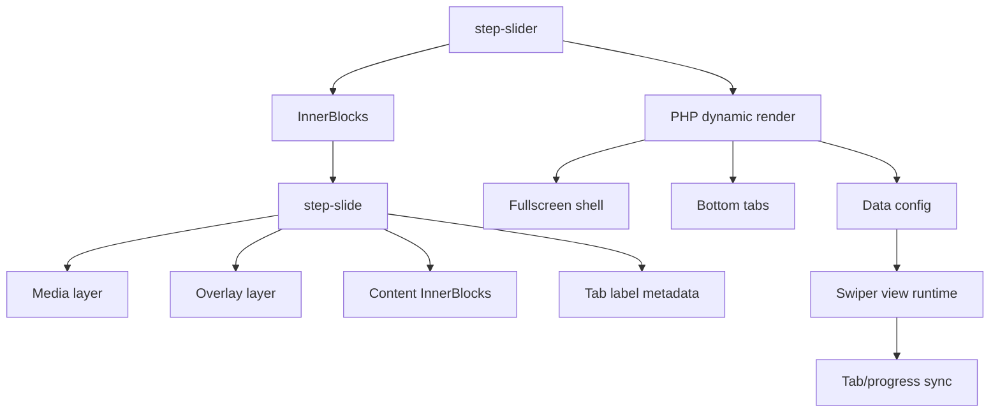

# Fullscreen Step Slider — 1.3.10 Architecture Decision

Date: 2026-06-08
Status: ACTIVE
Milestone: V1 / 1.3.24 (origin1.3.10 DEFERRED)
Lifecycle: active
Notes: Human gán 1.3.24 ngày 2026-11-07. Pointer hiện tại là 1.3.24, PLANNED, chưa start. Handoff code là plan 079. Filename giữ để bảo toàn liên kết. Status ACTIVE không là runtime PASS và không phải lệnh implement.

## Product contract update — 2026-11-09

Human chốt O01–O13 trong [plan018, Contract hiện hành](../../../../.context/planning/018_VERSION_1_3_10_FULLSCREEN_STEP_SLIDER_PLANNING.md#contract-hiện-hành--human-chốt-2026-11-09). Phần kiến trúc bên dưới tiếp tục áp dụng khi không trái contract mới. Các khác biệt cần đặc biệt lưu ý:

- Không swipe/drag. Tab và mũi tên vẫn có.
- Fullscreen là chiều cao tối thiểu và có thể nở theo nội dung; không dùng vùng cuộn nội dung riêng như technical report §5.6/§9 đề xuất. Artifact `min-height`/`autoHeight` là mẫu, chưa có runtime acceptance cho nội dung dài.
- **Điều chỉnh 2026-11-16:** autoplay và loop **mặc định On** ở giai đoạn dev 2. Manual là tắt autoplay, làm ở giai đoạn dev 1 và giữ lại. Dwell chung 5/8/10 giây, mặc định 8, tách khỏi transition. Progress chỉ đo dwell sau khi transition xong. O08-E chưa có ngưỡng, chưa nằm trong hai giai đoạn dev.
- **Điều chỉnh 2026-11-16:** lượt 1.3.24 gồm fade, wipe và text cascade ở giai đoạn dev 1. Ken Burns vẫn Deferred. O11-A (chỉ fade) không còn hiệu lực.
- Template 3/4/5 mặc định 4, cho native add/remove/reorder, cap thêm mới 8; child content lượt đầu giới hạn heading/paragraph/list/buttons. Print đủ bước, deep-link từng bước deferred.

Khi người xem cuộn bước dài, dwell vẫn chạy. Đề xuất dừng autoplay đến khi bấm Play chưa được chốt. Geometry và timing Swiper kiểm trong plan 079. Contract này không tự start milestone 1.3.24.

## Decision

Build Fullscreen Step Slider as a dedicated dynamic block family:

```text
skvn-marine/step-slider
skvn-marine/step-slide
```

It will reuse the V1 / 1.3.0 dynamic Slider foundation, Swiper dependency,
media/content layer contract, and reduced-motion conventions. It will not be a
variation of `skvn-marine/slider`.

## Rationale

The feature has a different interaction contract from Hero/Product/Card Slider:

- Sequential process/timeline storytelling.
- Bottom tab navigation.
- Per-step progress.
- Wipe/text cascade motion.
- Step labels derived from child slide metadata.

Treating it as a fourth Slider variation would overload the base Slider with
conditional behavior and make future maintenance harder.

## Adopted From The Report

- Dynamic PHP render direction.
- Fullscreen media, overlay, and content layers.
- Bottom tab navigation.
- Progress bar synchronized with slide duration.
- Wipe and text cascade motion concepts.
- Conditional frontend initialization.

## Rejected From The Report

- `slides: array` as the source data model.
- Custom `SlideRepeater`.
- Custom autoplay timer beside Swiper.
- Raw arbitrary color, pixel, timing, and class controls.
- Static saved frontend markup.

## Architecture



## Control Policy

> Danh sách preset bên dưới là bản 2026-06-08. Height viewport/tall/medium và Motion cinematic/gentle/none không còn là schema để code. O02 và điều chỉnh 2026-11-16 thay chúng. Schema nằm ở plan 079.

Controls must use governed presets:

```text
Height: viewport / tall / medium
Overlay: light / medium / strong
Text position: left / center / right
Motion: cinematic / gentle / none
CTA: primary / outline / text
Tab style: line / compact / numbers
```

Do not expose raw class input, raw color values, raw transition milliseconds, or
raw pixel typography controls in V1 / 1.3.10.

## Dependency

This milestone depends on V1 / 1.3.0 being complete enough to provide:

- Dynamic PHP render conventions.
- Shared media/content layer contract.
- Shared Swiper lifecycle.
- Shared reduced-motion behavior.
- Deploy artifact handling for plugin PHP runtime modules.

## Non-Goals

- No custom slide manager.
- No `slides` array replacing InnerBlocks.
- No second Slider runtime.
- No Fullscreen Step Slider implementation inside the existing Hero Slider
  variation.
- No video background support unless separately approved with performance and
  mobile behavior rules.
