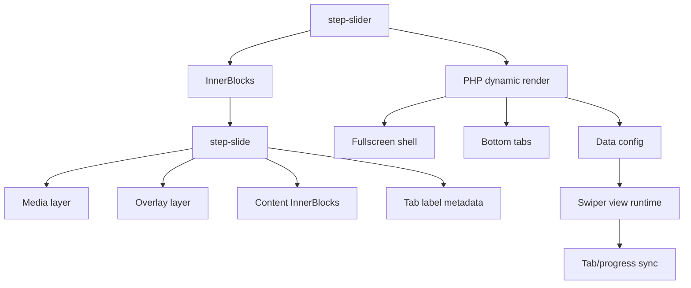

# Fullscreen Step Slider — 1.3.10 Architecture Decision

Date: 2026-06-08
Status: ACTIVE
Milestone: V1 / 1.3.24 (origin1.3.10 DEFERRED)
Lifecycle: active
Notes: Human gán1.3.24 ngày2026-11-07, PLANNED/chưa start; current giữ1.3.20. Filename giữ để bảo toàn liên kết (trước đây đổi từ1.5.0); không phải current hoặc implementation approval. Status ACTIVE không là runtime PASS; architecture/research còn mở theo plan018 phải được chốt trước source.

## Product contract update — 2026-11-09

Human chốt O01–O13 trong [plan018, Contract hiện hành](../../../../.context/planning/018_VERSION_1_3_10_FULLSCREEN_STEP_SLIDER_PLANNING.md#contract-hiện-hành--human-chốt-2026-11-09). Phần kiến trúc bên dưới tiếp tục áp dụng khi không trái contract mới. Các khác biệt cần đặc biệt lưu ý:

- Step Slider **manual mặc định**, no swipe/drag; arrows và direct-step tabs vẫn có. `loop` là setting mặc định **Off**, không còn mặc định `true` như research technical report §3.2.
- Fullscreen là chiều cao tối thiểu và có thể nở theo nội dung; không dùng vùng cuộn nội dung riêng như technical report §5.6/§9 đề xuất. Artifact `min-height`/`autoHeight` là mẫu, chưa có runtime acceptance cho nội dung dài.
- Autoplay dùng **một dwell time chung** 5/8/10 giây (mặc định 8 khi bật), tách khỏi **transition time**. Dwell bắt đầu sau khi chuyển bước hoàn tất; progress chỉ đo dwell. Editor có nhắc nhở nhỏ, không chặn lưu, khi nội dung có nguy cơ không đọc kịp; gợi ý tăng dwell chung, rút gọn/tách nội dung hoặc dùng manual. Chưa chốt giá trị transition và ngưỡng nhắc nhở.
- Lượt đầu dùng fade. Wipe/text cascade/Ken Burns trong §Rationale/§Adopted và plan018 §8 là **Deferred có truy vết**, không phải acceptance runtime đã PASS; không tự gỡ các ý tưởng đó khỏi backlog.
- Template 3/4/5 mặc định 4, cho native add/remove/reorder, cap thêm mới 8; child content lượt đầu giới hạn heading/paragraph/list/buttons. Print đủ bước, deep-link từng bước deferred.

Review còn mở: khi người xem đang cuộn đọc bước dài mà autoplay tới hạn, tooltip editor một mình không giải quyết được. Đề xuất dừng autoplay đến khi bấm Play chưa được human chốt. Cần mockup/QA geometry và timing Swiper trước implementation; quyết định O01–O13 không tự start milestone 1.3.24.

## Decision

Build Fullscreen Step Slider as a dedicated dynamic block family:

```text
skvn-marine/step-slider
skvn-marine/step-slide
```

It will reuse the V1 / 1.3.0 dynamic Slider foundation, Swiper dependency,
media/content layer contract, and reduced-motion conventions. It will not be a
variation of `skvn-marine/slider`.

## Rationale

The feature has a different interaction contract from Hero/Product/Card Slider:

- Sequential process/timeline storytelling.
- Bottom tab navigation.
- Per-step progress.
- Wipe/text cascade motion.
- Step labels derived from child slide metadata.

Treating it as a fourth Slider variation would overload the base Slider with
conditional behavior and make future maintenance harder.

## Adopted From The Report

- Dynamic PHP render direction.
- Fullscreen media, overlay, and content layers.
- Bottom tab navigation.
- Progress bar synchronized with slide duration.
- Wipe and text cascade motion concepts.
- Conditional frontend initialization.

## Rejected From The Report

- `slides: array` as the source data model.
- Custom `SlideRepeater`.
- Custom autoplay timer beside Swiper.
- Raw arbitrary color, pixel, timing, and class controls.
- Static saved frontend markup.

## Architecture



## Control Policy

Controls must use governed presets:

```text
Height: viewport / tall / medium
Overlay: light / medium / strong
Text position: left / center / right
Motion: cinematic / gentle / none
CTA: primary / outline / text
Tab style: line / compact / numbers
```

Do not expose raw class input, raw color values, raw transition milliseconds, or
raw pixel typography controls in V1 / 1.3.10.

## Dependency

This milestone depends on V1 / 1.3.0 being complete enough to provide:

- Dynamic PHP render conventions.
- Shared media/content layer contract.
- Shared Swiper lifecycle.
- Shared reduced-motion behavior.
- Deploy artifact handling for plugin PHP runtime modules.

## Non-Goals

- No custom slide manager.
- No `slides` array replacing InnerBlocks.
- No second Slider runtime.
- No Fullscreen Step Slider implementation inside the existing Hero Slider
  variation.
- No video background support unless separately approved with performance and
  mobile behavior rules.
